<picture>
  <source media="(prefers-color-scheme: dark)" srcset=".github/assets/header-dunkel.svg">
  
</picture>

     

<h3 align="center">Teach an agent a job once. Reuse it in every harness.</h3>

Reusable instructions for AI agents: official and community skill libraries, engineering and platform skills, subagent teams, rules files, prompts and system prompts, plus the tooling to build, route and sync skills. Creative skills live in the Creator Stack and business skills in AI at Work, so this list stays about how agents build and behave.

<!-- onboarding:start -->
### In 3 Minuten startklar

<picture>
  <source media="(prefers-color-scheme: dark)" srcset=".github/assets/onboarding-dunkel.svg">
  
</picture>

1. **Start here.** Oben unter [Start here](#start-here) stehen 4 Picks, einer je Rolle. Fang mit dem an, der zu deiner Lücke passt.
2. **Rubrik.** Unter [Contents](#contents) die Rubrik wählen: jedes Repo steht genau einmal da, nach der Aufgabe, die es erledigt.
3. **Ausprobieren.** Den Pick öffnen und seine Install-Zeile ausführen; die Sterne zeigen, wie viele ihn schon nutzen.
4. **Dranbleiben.** Dieser Liste einen Stern geben: neue Picks erscheinen in deinem GitHub-Feed.

**Was du davon hast**

- Die Repos rund um Agent Skills an einem Ort, nach Aufgabe sortiert, statt tagelang selbst zu suchen.
- Jeder Pick sagt in einem Satz, wofür er gut ist.
- Aufgenommen wird nur, was öffentlich ist, eine Lizenz hat und heute läuft.

**Nächster Schritt:** Fehlt ein Repo? Über [CONTRIBUTING.md](CONTRIBUTING.md) vorschlagen, ein Satz zur Aufgabe genügt; mehr Listen auf [github.com/Wellux](https://github.com/Wellux).
<!-- onboarding:end -->

## Start here

No time for 225 repos? Start with these 4, one per role. Add the rest when you feel the gap.

| Role | Pick | Why |
|:--|:--|:--|
| **Spec** | [agentskills](https://github.com/agentskills/agentskills) `★ 26.7k` | The open Agent Skills format, specified and documented in one place |
| **Library** | [anthropics/skills](https://github.com/anthropics/skills) `★ 184.5k` | Official reference skills, plus skill-creator to write your own |
| **Install** | [vercel-labs/skills](https://github.com/vercel-labs/skills) `★ 37k` | One npx command to add any skill repo to the agents you use |
| **Rules** | [agents.md](https://github.com/agentsmd/agents.md) `★ 25.2k` | The open AGENTS.md format that tells coding agents how a repo works |

<picture>
  <source media="(prefers-color-scheme: dark)" srcset=".github/assets/map-dunkel.svg">
  
</picture>

## Contents

- [Skill libraries](#skill-libraries) · 68 [Official vendor skills](#official-vendor-skills) · [Engineering skill packs](#engineering-skill-packs) · [Multi-domain collections](#multi-domain-collections) · [Awesome skill and plugin lists](#awesome-skill-and-plugin-lists)
- [Skill tooling](#skill-tooling) · 31 [Specs, registries and installers](#specs-registries-and-installers) · [Skill builders and optimizers](#skill-builders-and-optimizers) · [Skill routing and management](#skill-routing-and-management)
- [Skills for software work](#skills-for-software-work) · 41 [Apple and mobile](#apple-and-mobile) · [Web, backend and cloud](#web-backend-and-cloud) · [Quality, review and ops](#quality-review-and-ops) · [Product and planning](#product-and-planning) · [Game development](#game-development)
- [Subagents and roles](#subagents-and-roles) · 15 [Subagent collections](#subagent-collections) · [Roles, personas and AI teams](#roles-personas-and-ai-teams)
- [Rules and context](#rules-and-context) · 22 [Rules files and AGENTS.md](#rules-files-and-agentsmd) · [Context engineering kits](#context-engineering-kits)
- [Prompts and system prompts](#prompts-and-system-prompts) · 48 [Prompt libraries](#prompt-libraries) · [System prompts](#system-prompts) · [Prompt engineering guides](#prompt-engineering-guides) · [Prompt tooling](#prompt-tooling)

## Skill libraries

The big shelves of official and community skills.

### Official vendor skills

- **[anthropics/skills](https://github.com/anthropics/skills)** `★ 184.5k` · Anthropic's public repository of Agent Skills.
- **[claude-plugins-official](https://github.com/anthropics/claude-plugins-official)** `★ 45.1k` · Official, Anthropic-managed directory of Claude Code plugins.
- **[knowledge-work-plugins](https://github.com/anthropics/knowledge-work-plugins)** `★ 33.7k` · Anthropic's open-source plugins for knowledge workers in Claude Cowork, one per job function.
- **[vercel-labs/agent-skills](https://github.com/vercel-labs/agent-skills)** `★ 33.2k` · Vercel's official collection of agent skills.
- **[openai/skills](https://github.com/openai/skills)** `★ 28.4k` · Official skills catalog for Codex.
- **[google/skills](https://github.com/google/skills)** `★ 21.6k` · Agent Skills for Google products and technologies.
- **[MiniMax-AI/skills](https://github.com/MiniMax-AI/skills)** `★ 13.7k` · MiniMax's skills for app development, Office files and media generation through MiniMax APIs.
- **[huggingface/skills](https://github.com/huggingface/skills)** `★ 11.2k` · Gives agents access to the Hugging Face ecosystem through skills.
- **[android/skills](https://github.com/android/skills)** `★ 10k` · Official Android skills that ground coding agents in current Android development practice.
- **[gemini-skills](https://github.com/google-gemini/gemini-skills)** `★ 4.4k` · Official skills for the Gemini API, its SDKs and model or agent interactions.
- **[NVIDIA/skills](https://github.com/NVIDIA/skills)** `★ 3.8k` · Agent skills for NVIDIA products, installable into Claude Code, Codex and other coding agents.
- **[expo/skills](https://github.com/expo/skills)** `★ 3.6k` · Official agent skills for Expo projects and Expo Application Services.
- **[cloudflare/skills](https://github.com/cloudflare/skills)** `★ 3.2k` · Skill set for teaching agents how to build on Cloudflare.
- **[microsoft/skills](https://github.com/microsoft/skills)** `★ 3.2k` · Microsoft skills, MCP servers, custom agents and AGENTS.md files that ground coding agents in SDKs.
- **[supabase/agent-skills](https://github.com/supabase/agent-skills)** `★ 2.9k` · Official Supabase skills that help developers work with Supabase through AI agents.
- **[WordPress/agent-skills](https://github.com/WordPress/agent-skills)** `★ 2.3k` · WordPress skills that teach coding assistants blocks, themes, plugins and best practices.
- **[langchain-skills](https://github.com/langchain-ai/langchain-skills)** `★ 1.3k` · Agent skills for building agents with LangChain, LangGraph and Deep Agents.
- **[skills-for-fabric](https://github.com/microsoft/skills-for-fabric)** `★ 1.3k` · Microsoft's skills and MCP servers for working with Microsoft Fabric from a CLI, VS Code or Claude.
- **[hyperagent-public-skills](https://github.com/alex-hyperagent/hyperagent-public-skills)** `★ 1.2k` · 15 skills from the Hyperagent team for brand books, design systems, claymation videos and data viz.
- **[power-platform-skills](https://github.com/microsoft/power-platform-skills)** `★ 1.1k` · Plugin marketplace for GitHub Copilot and other AI agents with Power Platform development plugins.
- **[simonw/claude-skills](https://github.com/simonw/claude-skills)** `★ 929` · Snapshot of the /mnt/skills folder from Claude's code interpreter environment.
- **[skills-for-copilot-studio](https://github.com/microsoft/skills-for-copilot-studio)** `★ 483` · Skill that lets AI coding tools build and edit Microsoft Copilot Studio agents as YAML.
- **[adobe/skills](https://github.com/adobe/skills)** `★ 316` · Adobe's agent skills for Analytics, Workfront, Experience Manager, App Builder and Commerce.
- **[plugin-marketplace](https://github.com/xai-org/plugin-marketplace)** `★ 312` · Official plugin marketplace published by xAI.
- **[OpenRouterTeam/skills](https://github.com/OpenRouterTeam/skills)** `★ 309` · Agent skills for building with OpenRouter's unified API for many AI models.

### Engineering skill packs

- **[superpowers](https://github.com/obra/superpowers)** `★ 307.5k` · **Top pick.** Agentic skills framework and software development methodology for coding agents.
- **[mattpocock/skills](https://github.com/mattpocock/skills)** `★ 305.8k` · **Top pick.** Small, composable skills for real engineering work, taken from Matt Pocock's .agents directory.
- **[addyosmani/agent-skills](https://github.com/addyosmani/agent-skills)** `★ 111.5k` · Engineering skills for AI coding agents such as Claude Code, Codex, Cursor and Antigravity.
- **[compound-engineering-plugin](https://github.com/EveryInc/compound-engineering-plugin)** `★ 25.8k` · Official Compound Engineering plugin for Claude Code, Codex, Cursor and more.
- **[Jeffallan/claude-skills](https://github.com/Jeffallan/claude-skills)** `★ 12.1k` · 67 specialized skills that turn Claude Code into a pair programmer for full-stack developers.
- **[agent-scripts](https://github.com/steipete/agent-scripts)** `★ 7.4k` · Shared AGENTS.md rules, workflow skills, helper scripts and hooks from Peter Steinberger's repos.
- **[tw93/Waza](https://github.com/tw93/Waza)** `★ 7.4k` · Engineering habits turned into skills that Claude Code, Codex and Cursor can run.
- **[antfu/skills](https://github.com/antfu/skills)** `★ 6k` · Anthony Fu's curated collection of agent skills.
- **[elephant-goldfish-model](https://github.com/google/elephant-goldfish-model)** `★ 4.8k` · Open-source skills for designing and reviewing software with AI agents.
- **[BuilderIO/skills](https://github.com/BuilderIO/skills)** `★ 4.6k` · Small composable skills for agents covering planning, recaps, orchestration and delivery.
- **[Dimillian/Skills](https://github.com/Dimillian/Skills)** `★ 4k` · Codex skills for Apple platforms, GitHub, refactors, review swarms and React performance.
- **[pstack-claude](https://github.com/michael-denyer/pstack-claude)** `★ 3.6k` · Versions of Poteto's pstack agent workflow for Claude Code, Codex, Copilot, Pi and OpenCode.
- **[tstack](https://github.com/t3dotgg/tstack)** `★ 2.3k` · Everyday agent skills for Claude Code and Codex, from shipping PRs to multi-model review.
- **[cc-thinking-skills](https://github.com/tjboudreaux/cc-thinking-skills)** `★ 1.7k` · 28 mental-model and critical-thinking skills for Claude Code, Copilot, Codex, Cursor and others.
- **[dzhng/skills](https://github.com/dzhng/skills)** `★ 1.4k` · Agent skills for software factories: explore ideas, write specs, implement, review and research.
- **[agent](https://github.com/noobnooc/agent)** `★ 1.4k` · Personal Codex skills for pre-launch audits and a reliability overlay for coding work.
- **[loopkit](https://github.com/Archive228/loopkit)** `★ 755` · 33 skills and a minimal .claude harness for any coding agent.
- **[coleam00/skills](https://github.com/coleam00/skills)** `★ 722` · Personal skills for building software with coding agents: PIV loop, planning and worktrees.
- **[absolute](https://github.com/dhruvjainin/absolute)** `★ 223` · Eleven agent skills for a daily think, spec, plan and build loop plus codebase health checks.
- **[claude-code-plugins](https://github.com/doodledood/claude-code-plugins)** `★ 38` · Marketplace of Claude Code plugins for agentic development workflows, including architecture tools.

### Multi-domain collections

- **[alirezarezvani/claude-skills](https://github.com/alirezarezvani/claude-skills)** `★ 28.9k` · 380+ skills, 30+ agents and 70+ commands for coding agents, from engineering to finance.
- **[baoyu-skills](https://github.com/JimLiu/baoyu-skills)** `★ 27k` · Baoyu's shared skills for daily work with AI agents such as Claude Code, Codex and OpenClaw.
- **[garden-skills](https://github.com/ConardLi/garden-skills)** `★ 13.4k` · Open-source skills collection covering web design, knowledge retrieval, image generation and more.
- **[davidondrej/skills](https://github.com/davidondrej/skills)** `★ 4.2k` · David Ondrej's agent skills for codebases, research, content and transcript workflows.
- **[tons-of-skills-marketplace](https://github.com/jeremylongshore/tons-of-skills-marketplace)** `★ 2.9k` · Model-agnostic agent-skills platform with verified adapters and the ccpi package manager.
- **[awesome-claude-code-toolkit](https://github.com/rohitg00/awesome-claude-code-toolkit)** `★ 2.8k` · Toolkit of Claude Code agents, skills, commands, plugins and hooks collected in one repo.
- **[wondelai/skills](https://github.com/wondelai/skills)** `★ 2.5k` · Agent skills and guided journeys based on business, marketing, UX and coding books.
- **[huashu-skills](https://github.com/alchaincyf/huashu-skills)** `★ 2.1k` · Index of 52 open-source agent skills with an install protocol, skills.json and update checks.
- **[claude-code-skills](https://github.com/daymade/claude-code-skills)** `★ 1.5k` · Claude Code skills marketplace for development, research, content and floor plan searches.
- **[aiwg](https://github.com/jmagly/aiwg)** `★ 225` · Agents, skills, rules and workflows for software, campaigns, incidents and research across AI tools.
- **[a-bunch-of-skills](https://github.com/nateherkai/a-bunch-of-skills)** `★ 66` · Collection of custom Claude Code skills.

### Awesome skill and plugin lists

- **[VoltAgent/awesome-agent-skills](https://github.com/VoltAgent/awesome-agent-skills)** `★ 36.5k` · **Top pick.** Curated collection of 1000+ agent skills from official dev teams and the community.
- **[ComposioHQ/awesome-claude-skills](https://github.com/ComposioHQ/awesome-claude-skills)** `★ 78.2k` · Curated list of 1000+ Claude skills and plugins that also work in Codex, Cursor and Gemini CLI.
- **[agentic-awesome-skills](https://github.com/sickn33/agentic-awesome-skills)** `★ 48.7k` · Catalog of 2,750+ agent skills with a local CLI and MCP for search, selection and validation.
- **[awesome-codex-skills](https://github.com/composio-community/awesome-codex-skills)** `★ 17.1k` · Curated list of Codex skills for automating workflows across the Codex CLI and API.
- **[travisvn/awesome-claude-skills](https://github.com/travisvn/awesome-claude-skills)** `★ 15.6k` · Curated list of Claude skills, resources and tools for customizing Claude workflows.
- **[BehiSecc/awesome-claude-skills](https://github.com/BehiSecc/awesome-claude-skills)** `★ 10.3k` · Curated list of Claude Skills.
- **[heilcheng/awesome-agent-skills](https://github.com/heilcheng/awesome-agent-skills)** `★ 6.3k` · Tutorials, guides and directories of agent skills.
- **[claude-plugins-community](https://github.com/anthropics/claude-plugins-community)** `★ 4.8k` · Read-only mirror of the community plugin marketplace for Claude Cowork and Claude Code.
- **[composio-community/awesome-claude-plugins](https://github.com/composio-community/awesome-claude-plugins)** `★ 2k` · Curated list of plugins that extend Claude Code with commands, agents, hooks and MCP servers.
- **[quemsah/awesome-claude-plugins](https://github.com/quemsah/awesome-claude-plugins)** `★ 1.5k` · Automated index of Claude Code plugins with adoption metrics from GitHub repositories.
- **[awesome-copilot-agents](https://github.com/Code-and-Sorts/awesome-copilot-agents)** `★ 588` · Curated list of instructions, prompts, skills, MCPs and agent files for GitHub Copilot.
- **[karanb192/awesome-claude-skills](https://github.com/karanb192/awesome-claude-skills)** `★ 573` · Curated collection of 50+ verified skills for Claude Code, Claude.ai and the API.

<a href="#contents">back to contents</a>

## Skill tooling

Make, find, test and sync skills.

### Specs, registries and installers

- **[skillshare](https://github.com/runkids/skillshare)** `★ 2.9k` · **Top pick.** Syncs skills, agents, MCP servers and plugins to all AI CLI tools with one command.
- **[vercel-labs/skills](https://github.com/vercel-labs/skills)** `★ 37k` · Open agent skills tool, run with npx skills.
- **[agentskills](https://github.com/agentskills/agentskills)** `★ 26.7k` · Specification and documentation for the Agent Skills format.
- **[openskills](https://github.com/numman-ali/openskills)** `★ 10.8k` · Universal skills loader for AI coding agents, installed with npm.
- **[OpenSpace](https://github.com/HKUDS/OpenSpace)** `★ 7.8k` · Skill management layer that retrieves, evaluates and evolves skills for AI agents.
- **[tech-leads-club/agent-skills](https://github.com/tech-leads-club/agent-skills)** `★ 7.1k` · Secure, validated skill registry for coding agents such as Claude Code, Cursor and Copilot.
- **[midudev/autoskills](https://github.com/midudev/autoskills)** `★ 7k` · Scans a project's tech stack and installs matching agent skills from an audited registry.
- **[teamai-cli](https://github.com/Tencent/teamai-cli)** `★ 5.7k` · CLI that manages a team's skills, rules, agents, MCP and models as assets in a git repo.
- **[the-library](https://github.com/disler/the-library)** `★ 431` · Meta-skill for private-first distribution of skills, agents and prompts across agents and devices.
- **[company-skills-marketplace-template](https://github.com/bradautomates/company-skills-marketplace-template)** `★ 79` · Fork-and-go template for a private team skills marketplace for Claude Code and Codex CLI.
- **[upskill](https://github.com/Autoloops/upskill)** `★ 68` · CLI and skill for the Autoloops registry to search, inspect, report on and publish agent skills.

### Skill builders and optimizers

- **[Skill_Seekers](https://github.com/yusufkaraaslan/Skill_Seekers)** `★ 15.2k` · **Top pick.** Turns documentation sites, GitHub repos and PDFs into Claude skills with conflict detection.
- **[microsoft/waza](https://github.com/microsoft/waza)** `★ 1.5k` · **Top pick.** CLI to create, test, measure and improve the quality of agent skills.
- **[book-to-skill](https://github.com/virgiliojr94/book-to-skill)** `★ 36.4k` · Turns a technical book PDF into a Claude Code skill.
- **[SkillOpt](https://github.com/microsoft/SkillOpt)** `★ 18.8k` · Text-space optimizer that trains reusable natural-language skills for frozen LLM agents.
- **[autoharness](https://github.com/tigerless-labs/autoharness)** `★ 10.5k` · Self-learning skill layer for Claude Code that distills skills from your real sessions.
- **[harness](https://github.com/revfactory/harness)** `★ 9.3k` · Meta-skill that designs agent teams, defines specialized agents and generates their skills.
- **[refly](https://github.com/refly-ai/refly)** `★ 7.5k` · Open-source skills builder: define skills as workflows, run them on Claude Code, Cursor or Codex.
- **[skill-recorder](https://github.com/microsoft/skill-recorder)** `★ 5.5k` · Desktop app that records an on-screen work session and reconstructs it as an agent skill.
- **[one-skill-to-rule-them-all](https://github.com/rebelytics/one-skill-to-rule-them-all)** `★ 3.6k` · Meta-skill that builds and improves your skills by watching your work sessions.
- **[yao-meta-skill](https://github.com/yaojingang/yao-meta-skill)** `★ 2.7k` · Meta-skill system for engineering, evaluating, governing and porting reusable agent skills.
- **[skills-best-practices](https://github.com/mgechev/skills-best-practices)** `★ 2.3k` · Guide for writing agent skills, validating them with LLMs and keeping context lean.
- **[claude-code-skill-factory](https://github.com/alirezarezvani/claude-code-skill-factory)** `★ 896` · Toolkit for generating Claude skills, agents, slash commands and prompts from structured templates.
- **[AutoSkill](https://github.com/ECNU-ICALK/AutoSkill)** `★ 609` · Lifelong learning for agents through skills that evolve themselves from experience.
- **[robonuggets/skills](https://github.com/robonuggets/skills)** `★ 42` · Claude Code skills for in-session self-improvement and for adapting external inputs to your setup.
- **[calibrate](https://github.com/robonuggets/calibrate)** `★ 23` · Claude Code skill that reviews a session for corrections and patterns and suggests improvements.

### Skill routing and management

- **[Vibe-Skills](https://github.com/foryourhealth111-pixel/Vibe-Skills)** `★ 3.8k` · Skill routing and workflow orchestration for AI agents.
- **[CodexSkillManager](https://github.com/Dimillian/CodexSkillManager)** `★ 1.4k` · macOS app to manage your Codex skills.
- **[agentfiles](https://github.com/Railly/agentfiles)** `★ 858` · Browse, create and edit agent files for Claude Code, Codex, Cursor and others from Obsidian.
- **[SkillRouter](https://github.com/zhengyanzhao1997/SkillRouter)** `★ 269` · Retrieve-and-rerank skill selection for LLM agents at scale.
- **[B143KC47/autoskills](https://github.com/B143KC47/autoskills)** `★ 2` · Claude Code meta-skill that searches local and online skills and recommends the best fit.

<a href="#contents">back to contents</a>

## Skills for software work

Platform and task skills for developers.

### Apple and mobile

- **[SwiftUI-Agent-Skill](https://github.com/twostraws/SwiftUI-Agent-Skill)** `★ 6.4k` · **Top pick.** Skill that helps Claude Code, Codex and other AI tools write SwiftUI.
- **[app-store-preflight-skills](https://github.com/truongduy2611/app-store-preflight-skills)** `★ 1.4k` · Agent skill that scans iOS and macOS projects for App Store rejection patterns before submission.
- **[kotlin-agent-skills](https://github.com/Kotlin/kotlin-agent-skills)** `★ 1.1k` · Collection of AI agent skills for projects that use Kotlin.
- **[bama](https://github.com/daveebbelaar/bama)** `★ 596` · Agent skills to research, clone, build and test native macOS apps with Swift.
- **[fwc-swiftui-skills](https://github.com/FloWritesCode/fwc-swiftui-skills)** `★ 446` · Coding agent skills for modern SwiftUI development.
- **[apple-skills](https://github.com/Prisma-Labs-Dev/apple-skills)** `★ 349` · Skills for iOS 26+ development in Claude Code and Codex, covering SwiftUI and Liquid Glass.
- **[react-native-skills](https://github.com/margelo/react-native-skills)** `★ 178` · Agent skills for React Native development.

### Web, backend and cloud

- **[threejs-skills](https://github.com/CloudAI-X/threejs-skills)** `★ 3.8k` · Skill files that give Claude Code current knowledge of three.js and React Three Fiber.
- **[azure-skills](https://github.com/microsoft/azure-skills)** `★ 1.6k` · Official Microsoft agent plugin with skills and MCP server configs for Azure scenarios.
- **[aws-agent-skills](https://github.com/itsmostafa/aws-agent-skills)** `★ 1.2k` · Agent skills for working with AWS.
- **[Gentleman-Skills](https://github.com/Gentleman-Programming/Gentleman-Skills)** `★ 661` · Curated and community skills for Angular, React, Next.js, Tailwind, Django, testing and more.
- **[builder-skills](https://github.com/waynesutton/builder-skills)** `★ 405` · Skills for building Convex apps with a PRD, task and changelog workflow for Claude Code.
- **[specx](https://github.com/maksimzayats/specx)** `★ 200` · Agent skills and architecture checks for building structured Python services.
- **[obsidian-plugin-skill](https://github.com/gapmiss/obsidian-plugin-skill)** `★ 194` · Skill that teaches agents how to develop Obsidian plugins.
- **[convex-agent-plugins](https://github.com/convex/convex-agent-plugins)** `★ 117` · Official Convex plugins for Cursor and Claude Code with rules, skills, agents and MCP access.
- **[convex/agent-skills](https://github.com/convex/agent-skills)** `★ 69` · Skills for agents that build on Convex.
- **[triggerdotdev/skills](https://github.com/triggerdotdev/skills)** `★ 35` · Best practices for building AI agents and background jobs with Trigger.dev, as agent skills.
- **[chaingpt-claude-skill](https://github.com/Scottcjn/chaingpt-claude-skill)** `★ 18` · Claude Code skill for Web3 engineering with a full ChainGPT API reference and MCP tools.

### Quality, review and ops

- **[simplify-codebase](https://github.com/tt-a1i/simplify-codebase)** `★ 509` · Agent skill that proves and removes accidental codebase complexity without changing behavior.
- **[dispatch](https://github.com/bassimeledath/dispatch)** `★ 414` · Claude Code skill that stretches the context window by sending tasks to background AI workers.
- **[relay](https://github.com/Forward-Future/relay)** `★ 229` · Skill that routes work through planning, execution and review to optimize cost.
- **[manifest-dev](https://github.com/doodledood/manifest-dev)** `★ 77` · Skills for agentic coding CLIs that aim for output you can ship with minimal review.
- **[omarchy-plugin-security-skill](https://github.com/wbso-ai/omarchy-plugin-security-skill)** `★ 77` · Agent skill and field guide to the security pitfalls that block Omarchy plugins on the marketplace.
- **[module-sop](https://github.com/MrTrenchTrucker/module-sop)** `★ 5` · Skills and SOPs for building software in modules with a chain of AI agents.
- **[test-value](https://github.com/tt-a1i/test-value)** `★ 4` · Agent skill for tests worth maintaining: regression protection, fast feedback and low upkeep.
- **[ship-skill](https://github.com/ceoguy/ship-skill)** `★ 1` · Claude Code skill that builds per item, reviews adversarially until clean, then merges.
- **[workshop-skill-claude](https://github.com/ceoguy/workshop-skill-claude)** `★ 1` · Claude Code skill with verification and autonomy protocols plus a /workshop router command.

### Product and planning

- **[pm-skills](https://github.com/phuryn/pm-skills)** `★ 27.5k` · **Top pick.** Marketplace of 100+ product management skills, commands and plugins from discovery to launch.
- **[Product-Manager-Skills](https://github.com/deanpeters/Product-Manager-Skills)** `★ 7.7k` · Skills framework for product management, built on established methods, for Claude Code and Codex.
- **[vibe-coding-prompt-template](https://github.com/KhazP/vibe-coding-prompt-template)** `★ 3.2k` · Templates and workflow for generating PRDs, tech designs and MVPs with LLMs in AI IDEs.
- **[grill-me-skill](https://github.com/RobMitt/grill-me-skill)** `★ 1.2k` · Claude Code and Cowork skill that interviews you until you reach shared understanding.
- **[vibe-check](https://github.com/TexasBedouin/vibe-check)** `★ 628` · Skill that takes a beginner from a vague idea to a buildable plan and then guides them.
- **[VibeDoc](https://github.com/calderbuild/VibeDoc)** `★ 374` · AI product manager and architect that turns ideas into development plans with coding prompts.
- **[linear-claude-skill](https://github.com/wrsmith108/linear-claude-skill)** `★ 139` · Skill for managing Linear issues, projects and teams via MCP tools, the SDK and GraphQL.
- **[idea-to-ship-skills](https://github.com/nelsonwerd/idea-to-ship-skills)** `★ 90` · Composable skills for Claude and Codex that take an idea from fuzzy to validated to shipped.
- **[plan-for-goal](https://github.com/robonuggets/plan-for-goal)** `★ 42` · Claude Code skill that turns any brief into a structured plan ready to feed /goal.

### Game development

- **[Claude-Code-Game-Studios](https://github.com/Donchitos/Claude-Code-Game-Studios)** `★ 28.5k` · **Top pick.** Turns Claude Code into a game dev studio with 49 agents and 72 workflow skills.
- **[universal-modder](https://github.com/rehan-remade/universal-modder)** `★ 9.2k` · Skills, tools and a fal MCP that let Claude mod games.
- **[VibeGame](https://github.com/tettethu/VibeGame)** `★ 282` · Self-evolving multi-agent framework with an AI-native game engine that builds games from prompts.
- **[blender-game-skills](https://github.com/majidmanzarpour/blender-game-skills)** `★ 162` · Claude Code skills that turn concept art into rigged, game-ready 3D assets in Blender.
- **[everything-game-dev-code](https://github.com/MRCalderon3D/everything-game-dev-code)** `★ 99` · Scaffold of 42 agents, 51 commands and 86 skills for AI-assisted game development.

<a href="#contents">back to contents</a>

## Subagents and roles

Ready-made teammates you drop into a harness.

### Subagent collections

- **[wshobson/agents](https://github.com/wshobson/agents)** `★ 41.9k` · **Top pick.** Agent plugin marketplace for Claude Code, Codex, Cursor, OpenCode, Copilot and Antigravity.
- **[awesome-claude-code-subagents](https://github.com/VoltAgent/awesome-claude-code-subagents)** `★ 26.2k` · **Top pick.** Collection of 100+ specialized Claude Code subagents for a wide range of development use cases.
- **[contains-studio/agents](https://github.com/contains-studio/agents)** `★ 12.4k` · Collection of specialized Claude Code agents for every aspect of rapid development.
- **[awesome-codex-subagents](https://github.com/VoltAgent/awesome-codex-subagents)** `★ 6.4k` · Collection of 130+ specialized Codex subagents for a wide range of development use cases.
- **[awesome-claude-agents](https://github.com/vijaythecoder/awesome-claude-agents)** `★ 4.4k` · Orchestrated team of Claude Code subagents that acts as a dev team.
- **[claude-code-sub-agents](https://github.com/lst97/claude-code-sub-agents)** `★ 1.7k` · Collection of specialized subagents for full-stack development in Claude Code.
- **[claude-code-agents](https://github.com/undeadlist/claude-code-agents)** `★ 149` · Subagent prompt templates for Claude Code that run parallel code audits and fix cycles.

### Roles, personas and AI teams

- **[agency-agents](https://github.com/msitarzewski/agency-agents)** `★ 164.9k` · **Top pick.** Specialist agent personas grouped as an AI agency, from frontend engineering to community roles.
- **[agency-agents-zh](https://github.com/jnMetaCode/agency-agents-zh)** `★ 21.7k` · 277 ready-made AI expert roles for about 20 tools, including 64 for the Chinese market.
- **[self-driving-agents](https://github.com/vectorize-io/self-driving-agents)** `★ 3k` · 179 ready-made, self-learning agents in 13 departments for Claude Code, OpenClaw and Hermes.
- **[vibeship-spawner-skills](https://github.com/vibeforge1111/vibeship-spawner-skills)** `★ 885` · Skill directory of specialized agents for your terminal or IDE.
- **[the-startup](https://github.com/rsmdt/the-startup)** `★ 575` · Collection of Claude Code commands, skills and agents framed as an agentic startup.
- **[vibecosystem](https://github.com/vibeeval/vibecosystem)** `★ 540` · AI software team for Claude Code with 138 agents, 295 skills and 73 hooks.
- **[claude-cto-team](https://github.com/alirezarezvani/claude-cto-team)** `★ 119` · Subagents for Claude Code that act as a CTO team challenging your plans and execution.
- **[secretary](https://github.com/AgriciDaniel/secretary)** `★ 18` · Evidence-grounded secretary role for Claude Code and Codex with frozen context.

<a href="#contents">back to contents</a>

## Rules and context

What agents read before they touch your code.

### Rules files and AGENTS.md

- **[andrej-karpathy-skills](https://github.com/multica-ai/andrej-karpathy-skills)** `★ 226k` · **Top pick.** One CLAUDE.md that improves Claude Code behavior, based on Karpathy's LLM coding observations.
- **[awesome-cursorrules](https://github.com/PatrickJS/awesome-cursorrules)** `★ 41k` · **Top pick.** Configuration files that give the Cursor AI editor custom rules and behaviors.
- **[ponytail](https://github.com/DietrichGebert/ponytail)** `★ 179.2k` · Behavior rules that make an AI agent think like a lazy senior developer who writes less code.
- **[i-have-adhd](https://github.com/ayghri/i-have-adhd)** `★ 59.2k` · Skill that stops a coding agent from burying the answer, with ADHD-friendly output.
- **[agents.md](https://github.com/agentsmd/agents.md)** `★ 25.2k` · Open format for AGENTS.md files that guide coding agents.
- **[anti-slop](https://github.com/miqdadbadjuber/anti-slop)** `★ 7.5k` · Rules for an AI coding agent to filter out generic AI-made UI designs, text and code.
- **[devin.cursorrules](https://github.com/grapeot/devin.cursorrules)** `★ 6k` · Rules that turn Cursor or Windsurf into something close to Devin.
- **[unlazy](https://github.com/Leonxlnx/unlazy)** `★ 4.2k` · Anti-laziness skill for AI agents built on a Depth Tree method that splits tasks into layers.
- **[awesome-cursor-rules-mdc](https://github.com/sanjeed5/awesome-cursor-rules-mdc)** `★ 3.6k` · Curated list of Cursor Rules .mdc files.
- **[10x-Tool-Calls](https://github.com/perrypixel/10x-Tool-Calls)** `★ 852` · Lightweight rules file that helps you get more value from your monthly AI coding tool calls.
- **[agentic-cursorrules](https://github.com/s-smits/agentic-cursorrules)** `★ 644` · Cursor rules that manage multiple AI agents through file-tree partitioning and domain boundaries.
- **[rulebook-ai](https://github.com/botingw/rulebook-ai)** `★ 612` · Keeps custom instructions consistent across Copilot, Cursor, Roo Code, Cline and other assistants.
- **[A11Y.md](https://github.com/fecarrico/A11Y.md)** `★ 478` · Context system with enforceable WCAG-aligned rules for building accessible software by default.
- **[promptscript](https://github.com/mrwogu/promptscript)** `★ 378` · Standardizes, audits and deploys instructions across AI coding assistants as prompt-as-code.
- **[fixing-smartass-opus-5](https://github.com/disler/fixing-smartass-opus-5)** `★ 366` · Shows how one system prompt turns Opus 5 into a precise senior engineering partner.
- **[agentic-habits](https://github.com/AgriciDaniel/agentic-habits)** `★ 7` · Three-tier agent behavior: stated rules, a Stop-hook gate and a judge that scores adherence.

### Context engineering kits

- **[Agent-Skills-for-Context-Engineering](https://github.com/muratcankoylan/Agent-Skills-for-Context-Engineering)** `★ 18.2k` · **Top pick.** Skill collection for context engineering, multi-agent architectures and production agent systems.
- **[context-engineering-intro](https://github.com/coleam00/context-engineering-intro)** `★ 13.9k` · Intro and template for context engineering with AI coding assistants, centered on Claude Code.
- **[agentic-stack](https://github.com/codejunkie99/agentic-stack)** `★ 2.3k` · Portable .agent folder with memory, skills and protocols that plugs into several coding harnesses.
- **[context-engineering-kit](https://github.com/NeoLabHQ/context-engineering-kit)** `★ 1.8k` · Hand-crafted Claude Code skills that improve the quality of agent results.
- **[Interpretable-Context-Methodology](https://github.com/RinDig/Interpretable-Context-Methodology)** `★ 1.4k` · Uses folder structure as agent architecture instead of framework-level orchestration.
- **[Cline-Recursive-Chain-of-Thought-System-CRCT-](https://github.com/RPG-fan/Cline-Recursive-Chain-of-Thought-System-CRCT-)** `★ 762` · Framework that manages context, dependencies and tasks in large Cline projects inside VS Code.

<a href="#contents">back to contents</a>

## Prompts and system prompts

The text that steers models.

### Prompt libraries

- **[prompts.chat](https://github.com/f/prompts.chat)** `★ 175k` · **Top pick.** Community library to share, discover and collect prompts, formerly Awesome ChatGPT Prompts.
- **[Fabric](https://github.com/danielmiessler/Fabric)** `★ 44.5k` · Open-source framework with a modular system of AI prompts for solving specific problems.
- **[awesome-prompts](https://github.com/ai-boost/awesome-prompts)** `★ 9.1k` · Curated prompts, frameworks and papers for LLMs and agents.
- **[ChatGPT-Shortcut](https://github.com/rockbenben/ChatGPT-Shortcut)** `★ 8.9k` · Searchable prompt library for ChatGPT, Claude, Gemini and Cursor.
- **[SuperPrompt](https://github.com/NeoVertex1/SuperPrompt)** `★ 6.4k` · Single XML-tagged meta-prompt meant to push Claude and other LLMs toward more novel ideas.
- **[TheBigPromptLibrary](https://github.com/0xeb/TheBigPromptLibrary)** `★ 5.5k` · Collection of prompts, system prompts and LLM instructions.
- **[yao-open-prompts](https://github.com/yaojingang/yao-open-prompts)** `★ 3k` · Bilingual prompt library for prompt engineering, work, learning, content and marketing.
- **[GPT-Prompt-Hub](https://github.com/LichAmnesia/GPT-Prompt-Hub)** `★ 2.4k` · Community repository for collecting, sharing and refining GPT prompts.
- **[dev-chatgpt-prompts](https://github.com/PickleBoxer/dev-chatgpt-prompts)** `★ 2.3k` · Personal collection of ChatGPT prompts for developers.
- **[ChatGPT-System-Prompts](https://github.com/mustvlad/ChatGPT-System-Prompts)** `★ 1.2k` · Collection of system prompts for ChatGPT.
- **[PromptChains](https://github.com/MIATECHPARTNERS/PromptChains)** `★ 1.2k` · Collection of prompt chains for getting more out of LLMs.
- **[cline/prompts](https://github.com/cline/prompts)** `★ 1.2k` · Library of prompts from the Cline community.
- **[GPT-Prompts](https://github.com/jesselau76/GPT-Prompts)** `★ 809` · Collection of useful GPT prompts.
- **[Bot-Generator-Bot](https://github.com/ruvnet/Bot-Generator-Bot)** `★ 587` · Prompt that turns ChatGPT into a generator of custom ChatGPT bots.
- **[VoloBuilds/prompts](https://github.com/VoloBuilds/prompts)** `★ 288` · Coding prompts from the AI Coding 101 video, plus commands for briefs, plans, reviews and docs.
- **[PromptKit](https://github.com/microsoft/PromptKit)** `★ 113` · Composable, version-controlled agentic prompts treated as engineered code.
- **[OpenWebUI-Prompt-Library](https://github.com/danielrosehill/OpenWebUI-Prompt-Library)** `★ 49` · Slash prompts for Open WebUI that steer, format or hand over ongoing conversations.

### System prompts

- **[system_prompts_leaks](https://github.com/asgeirtj/system_prompts_leaks)** `★ 70.4k` · **Top pick.** Regularly updated system prompts of Claude, ChatGPT, Gemini, Grok, Cursor and other AI products.
- **[system-prompts-and-models-of-ai-tools](https://github.com/x1xhlol/system-prompts-and-models-of-ai-tools)** `★ 144.3k` · Collected system prompts of AI products such as Claude Code, Cursor, Devin AI and Lovable.
- **[CL4R1T4S](https://github.com/elder-plinius/CL4R1T4S)** `★ 51.6k` · Leaked system prompts of ChatGPT, Claude, Gemini, Grok, Perplexity, Cursor and more.
- **[GPTs](https://github.com/linexjlin/GPTs)** `★ 32k` · Collection of leaked system prompts from custom GPTs.
- **[leaked-system-prompts](https://github.com/jujumilk3/leaked-system-prompts)** `★ 15k` · Collection of leaked system prompts.
- **[claude-code-system-prompts](https://github.com/Piebald-AI/claude-code-system-prompts)** `★ 13k` · Every part of Claude Code's system prompt, tool descriptions and subagent prompts, per version.
- **[chatgpt_system_prompt](https://github.com/LouisShark/chatgpt_system_prompt)** `★ 10.8k` · Collection of GPT system prompts with notes on prompt injection and leaking.
- **[awesome-ai-system-prompts](https://github.com/dontriskit/awesome-ai-system-prompts)** `★ 6.3k` · Curated collection of system prompts from top AI tools for agent builders and prompt engineers.
- **[grok-prompts](https://github.com/xai-org/grok-prompts)** `★ 4.5k` · System prompts of the Grok chat assistant and the @grok bot on X.
- **[SystemPromptIndex](https://github.com/SystemPromptIndex/SystemPromptIndex)** `★ 37` · 1,017 system prompts from real AI products, audited against eight assurance dimensions.

### Prompt engineering guides

- **[Prompt-Engineering-Guide](https://github.com/dair-ai/Prompt-Engineering-Guide)** `★ 79.6k` · **Top pick.** Guides, papers and notebooks on prompt engineering, context engineering, RAG and AI agents.
- **[prompt-eng-interactive-tutorial](https://github.com/anthropics/prompt-eng-interactive-tutorial)** `★ 38.9k` · Anthropic's interactive prompt engineering tutorial.
- **[LangGPT](https://github.com/langgptai/LangGPT)** `★ 12.6k` · Structured prompt and meta-prompt framework with guides for writing prompts.
- **[prompt-engineering](https://github.com/brexhq/prompt-engineering)** `★ 9.6k` · Tips and tricks for prompting large language models such as GPT-4.
- **[Prompt_Engineering](https://github.com/NirDiamant/Prompt_Engineering)** `★ 7.9k` · 22 prompt engineering techniques taught with hands-on Jupyter notebooks.
- **[Awesome-Prompt-Engineering](https://github.com/promptslab/Awesome-Prompt-Engineering)** `★ 6.4k` · Hand-curated prompt engineering resources with a focus on GPT models.
- **[Learn_Prompting](https://github.com/trigaten/Learn_Prompting)** `★ 4.7k` · Guide to prompt engineering, generative AI and LLMs.
- **[PromptPapers](https://github.com/thunlp/PromptPapers)** `★ 4.3k` · Reading list of papers on prompt-based tuning for pre-trained language models.
- **[ChatGPT-Free-Prompt-List](https://github.com/mattnigh/ChatGPT-Free-Prompt-List)** `★ 2.3k` · Free guide to learning how to write ChatGPT prompts.
- **[udemy-prompt-engineering-course](https://github.com/BrightPool/udemy-prompt-engineering-course)** `★ 801` · Course content for a Udemy prompt engineering class.
- **[PROMPTING.md](https://github.com/Anbeeld/PROMPTING.md)** `★ 13` · Ruleset agents follow to write and audit prompts, skills, plans, instructions and handoffs.

### Prompt tooling

- **[prompt-master](https://github.com/nidhinjs/prompt-master)** `★ 15.2k` · Claude skill that writes accurate prompts for any AI tool without wasting tokens or credits.
- **[gpt-prompt-engineer](https://github.com/mshumer/gpt-prompt-engineer)** `★ 9.7k` · Generates, tests and ranks many prompts for a task from a description and test cases.
- **[openplayground](https://github.com/nat/openplayground)** `★ 6.3k` · Local LLM playground to compare models side by side and tune parameters.
- **[prompttools](https://github.com/hegelai/prompttools)** `★ 3.1k` · Open-source tools for testing and experimenting with prompts across LLMs and vector databases.
- **[gitreverse](https://github.com/filiksyos/gitreverse)** `★ 2k` · Turns any repo back into the prompt that could have built it.
- **[AI-Prompt-Genius](https://github.com/AI-Prompt-Genius/AI-Prompt-Genius)** `★ 1.3k` · Browser extension for curating a personal library of AI prompts.
- **[marimo-prompt-library](https://github.com/disler/marimo-prompt-library)** `★ 250` · Reusable, customizable prompt library built in Marimo reactive notebooks.
- **[goal-prompt-builder](https://github.com/win4r/goal-prompt-builder)** `★ 231` · Builds audit-friendly /goal prompts for OpenAI Codex.
- **[promptmaster-skill](https://github.com/Jakeschincariol/promptmaster-skill)** `★ 54` · Claude skill that rewrites your prompt into an optimized format.
- **[prompt-engineering-in-action](https://github.com/Exponential-OS/prompt-engineering-in-action)** `★ 10` · Co-Dialectic prompt coach that catches AI sycophancy and judges answers across model families.

<a href="#contents">back to contents</a>

## The Wellux awesome family

Every list comes from the same 6,623 starred repos, sorted by the job they do. Each repo has exactly one home.

| List | What is inside | Repos |
|:---|:---|---:|
| **[awesome-agent-os](https://github.com/Wellux/awesome-agent-os)** | Personal agents and the ecosystems around them: OpenClaw, Hermes, DeepSeek Harness, cockpits, company OS and devices. | 436 |
| **[awesome-coding-agents](https://github.com/Wellux/awesome-coding-agents)** | Claude Code, Codex, OpenCode, Pi and Herdr with setups, parallel sessions, loops, code context, usage and guides. | 459 |
| **awesome-agent-skills** (you are here) | Skill libraries, SKILL.md tooling, subagents, rules files, prompts and system prompts. | 225 |
| **[awesome-mcp-connectors](https://github.com/Wellux/awesome-mcp-connectors)** | MCP servers, gateways, connectors, agent CLIs, browser and computer use and web data that give agents hands. | 240 |
| **[awesome-agent-memory](https://github.com/Wellux/awesome-agent-memory)** | Memory layers, RAG, vector search, document parsing, second brains and research agents, so agents stop forgetting. | 289 |
| **[awesome-agent-engineering](https://github.com/Wellux/awesome-agent-engineering)** | Frameworks, multi-agent systems, workflows, voice agents, guardrails, evals and the courses to build them. | 369 |
| **[awesome-ai-models](https://github.com/Wellux/awesome-ai-models)** | Run, route, train and study AI models: local inference, gateways, open models, decision models, vision and robotics. | 594 |
| **[awesome-ai-creator-stack](https://github.com/Wellux/awesome-ai-creator-stack)** | Open-source AI tools and agent skills for creators: voice, video, motion, images, 3D, design, slides and writing. | 435 |
| **[awesome-ai-at-work](https://github.com/Wellux/awesome-ai-at-work)** | AI agents, apps and skills for real work: research, finance, marketing, sales, office, data, careers and industries. | 213 |

## How picks are made

1. Starred because it was useful, not because it trended.
2. Public on GitHub and mostly open source; check each license before you build on it.
3. One home per repo: the job it does best decides the section.
4. Inside a section: top picks first, then by stars.

Star counts as of 2026-10-29. 2 archived repos are left out.

## Contribute

Know a repo that does one job better? Open an issue with the link and one sentence on the job it does. Details in [CONTRIBUTING.md](CONTRIBUTING.md).

## Why this list exists

It is the shopping list behind **myOS**, an open-source personal operating system for you and your agents. myOS launches on **1 January 2027, 5 pm CET**. Watch <a href="https://github.com/Wellux">Wellux</a> to see it land, and star this list if it saved you an afternoon.

---

Curated by <a href="https://github.com/Wellux">Marco Mengele · Wellux</a> · From leak to solution. One block at a time.

